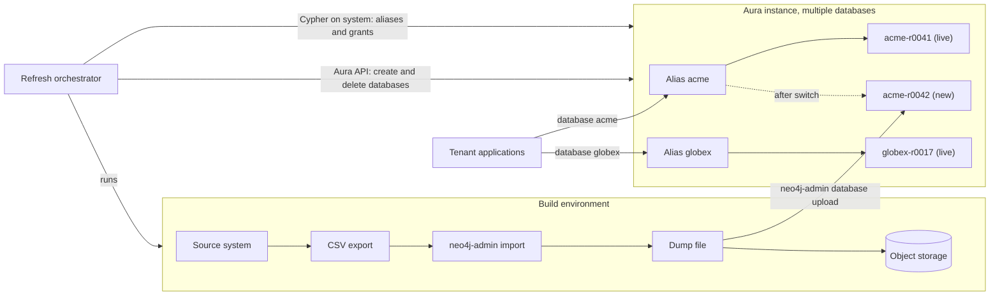
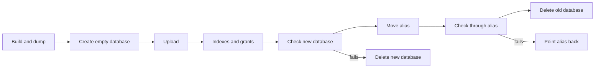

# Reference architecture: monthly full refresh with blue/green databases on Aura

**Applies to:** AuraDB Business Critical and Virtual Dedicated Cloud with multiple databases enabled, and self-managed Neo4j Enterprise Edition (appendix).

**Status:** draft. The pattern was run end to end on Aura Business Critical on 2026-10-28 ([evidence](docs/evidence/2026-10-28-aura-live-run.md)). Sizes and timings come from a small test and need confirming at production scale.

### How to read this

Recommendations carry one of two labels:

- **[Verified]** The step ran on Aura in the live test and the result is in the [evidence](docs/evidence/2026-10-28-aura-live-run.md).
- **[Design guidance]** The step follows from public Neo4j documentation, but the test harness did not exercise it. Test it in your own environment before relying on it.

---

## 1. Summary

Each tenant's graph is rebuilt in full on a schedule (monthly in this document) and swapped in without changing the application.

- **One Aura instance** holds the databases for many tenants.
- **Each tenant has one stable name**, such as `acme`. Applications always connect to that name. It is a [database alias](https://neo4j.com/docs/cypher-manual/current/administration/aliases/) that points at the tenant's current database.
- **Each refresh builds a new database** next to the live one, checks it, and moves the alias to it. The old database is then deleted.
- **The application's configuration never changes.**

### What "blue/green" means here

Classic blue/green runs two copies of an environment and moves traffic between them. Here the environment (the Aura instance) stays the same. The swap happens one level down, between two databases inside it:

- **Blue** is the tenant's current database.
- **Green** is the new build.
- **The alias** is the router.

Green only exists for the length of a refresh. There is no idle second environment to pay for, switch off, or keep in sync.

Changes to the instance itself, such as a version upgrade or a resize, use a different, two-instance pattern (section 10).

## 2. When to use this pattern

| Good fit | Poor fit |
| --- | --- |
| Data is rebuilt in full from a source system on a schedule | Data is written continuously by applications and must be kept |
| Many tenants of similar size and load | One or two large tenants, or one tenant much busier than the rest |
| Tenants can share a maintenance and failure domain | Each tenant needs its own uptime, pause, resize, or upgrade schedule |
| Bulk load with `neo4j-admin import` is acceptable | Changes must be applied incrementally |

Sections 8 and 9 explain the cost and isolation reasons behind this table.

**How far the evidence goes.** The pattern was tested once, with three tenants of about 10MB each, on one 2GB instance in one region. That proves the mechanism works. It does not show how upload time, cutover, or the effect on other tenants change at hundreds of GB or with dozens of tenants. Treat every number in this document as a starting point to measure against.

## 3. Architecture

| Component | Role |
| --- | --- |
| Aura instance | Business Critical or VDC with multiple databases enabled. This must be set at creation and cannot be changed later. |
| Tenant alias | The only database name applications use, for example `acme`. Never changes. |
| Tenant database | The physical database behind the alias, named with a sequence number: `acme-r0042`. |
| Build environment | A machine or container with Neo4j Enterprise tools. It never connects to live tenant databases. See "Tool version" below. |
| Object storage | Keeps the dump from each build. It is the long-term rollback and audit copy. |
| Refresh orchestrator | Runs the refresh, holds the Aura API credentials and the instance admin login, records each tenant's state, and raises alerts. This harness's `bg` CLI is one example. |

### Tool version

Aura does not report a precise server version (`dbms.components()` returns a value such as `5.27-aura`), so you cannot match the build tools to it exactly. Follow the compatibility table in the [Operations Manual's upload page](https://neo4j.com/docs/operations-manual/current/database-administration/standard-databases/upload-to-aura/) instead. At the time of writing, dumps made with Neo4j 5.26 LTS, 2025.x, or 2026.x can be uploaded to current Aura. Split dump archives (introduced in 2026.09) are not supported. Pin the tool version in the build environment, and test any upgrade by uploading to a scratch database first. **[Verified]** with Neo4j Enterprise 2026.10.1 tools.

### Naming

**[Design guidance]** The scheme below is a recommendation. The harness named databases `<tenant>-c<cycle>`, which behaves the same way.

- Alias: the tenant name (`acme`). Lowercase letters, digits, and dashes. Do not use `neo4j` or `system`.
- Database: `<tenant>-r<sequence>`, for example `acme-r0042`. The sequence goes up by one per build, so a second build in the same month (after a bad load) gets a new name. Record the source date and build ID in the orchestrator's state, not in the database name.
- Database names on Aura cannot be changed after creation. Names containing a dash must be quoted with backticks in Cypher.

## 4. The refresh

Refresh one tenant at a time. For each tenant:

1. **Build.** **[Verified]** Export CSV from the source system. Run `neo4j-admin database import full`, then `neo4j-admin database dump`. Store the dump in object storage with its build ID. (The harness kept dumps on local disk, not object storage.)
2. **Create an empty database** with the Aura API (`POST .../instances/{instanceId}/databases`). **[Verified]** On Aura, databases [cannot be created with Cypher](https://neo4j.com/docs/aura/managing-instances/multiple-databases/).
3. **Upload** with `neo4j-admin database upload --to-dbid <id>`. **[Verified]** The upload overwrites its target. The orchestrator must refuse to upload into the database the alias currently points at. The harness checks this before every upload.
4. **Prepare.**
   - Create indexes and constraints if the dump does not contain them, and wait until every index is `ONLINE` (`SHOW INDEXES`, or `CALL db.awaitIndexes()`). **[Verified]**
   - **Apply the tenant's privileges to the new database.** **[Design guidance]** Privileges are attached to the target database, not to the alias. Grants on `acme-r0041` do not carry over to `acme-r0042` (see section 6).
5. **Check the new database directly**, not through the alias:
   - Node and relationship counts match the build. **[Verified]**
   - A set of known queries returns the expected results. **[Verified]**
   - The tenant's own user can connect to it. **[Design guidance]**
   - If any check fails, delete the new database and stop. Nothing customers can see has changed.
6. **Move the alias.** **[Verified]** The first time, use ``CREATE ALIAS acme FOR DATABASE `acme-r0001` ``. After that, use ``ALTER ALIAS acme SET DATABASE TARGET `acme-r0042` ``. This is one change on the server. New queries for `acme` go to the new database from that moment.
7. **Check through the alias.** **[Verified]** Run the same known queries using `acme`. If they fail, point the alias back to `acme-r0041`. That is instant and needs no reload. **[Design guidance]** for the point-back, which the test did not exercise.
8. **Delete the old database** with the Aura API, before starting the next tenant. **[Verified]**

### What applications must do

- Connect with the alias (`database: "acme"`), never a physical name. Optionally, set each tenant user's home database to the alias.
- Use the driver's managed transactions (`executeRead` / `executeWrite` or the equivalent). The [Cypher manual](https://neo4j.com/docs/cypher-manual/current/administration/aliases/) warns that changing an alias may abort transactions running against it at that moment. Managed transactions retry them.
- Do not write to tenant data outside the refresh, or accept that those writes are replaced by the next build.

## 5. Rollback

**[Design guidance]** None of the three levels was exercised by the test. Pointing the alias back uses the same `ALTER ALIAS` command that was verified for the forward switch, so it is low risk, but rehearse it before you depend on it.

There are three levels, from fastest to slowest:

| Level | How | Available for |
| --- | --- | --- |
| Instant | Point the alias back to the previous database | Until that database is deleted (step 8) |
| Minutes | Create a database and upload the previous build's dump from object storage | As long as dumps are retained |
| Platform | Restore from Aura's database backups. Aura supports [backing up and restoring databases individually](https://neo4j.com/docs/aura/managing-instances/multiple-databases/) | Aura's backup retention |

The default is to keep the old database only until the checks through the alias pass, normally a few minutes. This keeps only one tenant doubled at a time (section 7).

If the business needs instant rollback for a day or more after each refresh, keep the old databases for that long. Then size the instance for every tenant refreshed in that window having two databases at once.

## 6. Security

**[Design guidance]** The test connected as the instance admin user throughout, so nothing in this section was exercised. The behaviour of privileges and aliases below is taken from the Cypher manual. Confirm it with a non-admin tenant user before your first production refresh.

- **One role and one user (or identity-provider group) per tenant.** Grant `ACCESS` and the needed graph privileges on that tenant's database only.
- **Privileges do not follow the alias.** For a local alias, the Cypher manual says: "Privileges are defined on the target database, and not the local database alias." A grant made using the alias name is recorded against the database it points at when the grant runs. So each refresh must re-apply the tenant's grants to the new database (step 4), and the check in step 5 must confirm the tenant user can read it.
- **Keep grants as code.** Store each tenant's privileges as a script the orchestrator replays for every new database. Then a refresh cannot silently drop or widen access.
- **Admin access stays with the orchestrator.** Applications never hold the instance admin login or Aura API credentials.
- **Tenants share one instance.** They share one `system` database, one set of servers, and one network boundary (IP filtering, private endpoints). If a tenant needs its own keys, network, or compliance boundary, give it its own instance.

## 7. Sizing

All databases on an instance share its memory, CPU, and storage.

- **Database count.** Aura allows 5 databases per GB of memory, up to 100 on Business Critical and 250 on VDC ([limits table](https://neo4j.com/docs/aura/managing-instances/multiple-databases/)). Count one per tenant, one extra for the tenant being refreshed, and one slot of headroom for the default `neo4j` database. A project can have 20 multi-database instances by default.
- **Memory.** Size for the combined working set of the live tenants that are queried at the same time. The page cache is shared, so a large or busy tenant can push others' data out of memory.
- **Storage.** Each instance size includes a base amount of storage, and [extra storage is charged](https://neo4j.com/docs/aura/managing-instances/instance-actions/). Size the disk for all live tenants plus the largest tenant's new copy.
- **Refresh order.** Refresh tenants one after another, and delete each old database before starting the next. Then only one tenant is doubled at a time.

## 8. Cost, and when sharing an instance pays off

Aura charges [by GB-hour of instance memory, regardless of the number of databases](https://neo4j.com/docs/aura/managing-instances/multiple-databases/). Within a region the rate is linear, so equal amounts of total memory cost the same.

- **The refresh itself adds nothing to the bill.** The new copy uses disk and a database slot on an instance you already pay for. The exception is when it needs more storage than the instance includes.
- **Deleting a database does not lower the bill.** It frees disk and a slot.

**Sharing saves money when many small tenants would each need their own instance.** Business Critical sizes start at 2GB and double. Ten tenants that each need less than 2GB cost 10 × 2GB = 20 GB-hours per hour as separate instances. Together they might fit on one 8GB instance, at 8 GB-hours per hour.

**Sharing saves nothing when tenants already fill an instance size.** One 8GB instance costs the same as two 4GB instances. Combining two large tenants adds noisy neighbors and a shared failure domain for no saving, so keep them apart.

### Noisy neighbors

Every database on an instance runs on the same servers. Expect one tenant to slow the others when:

- **Its queries are much heavier**, or arrive at a different time of day.
- **Its working set is large** and pushes others' data out of the shared memory.
- **It is being refreshed.** In the test, uploading a small (about 10MB) dump took about 3 minutes and used the same instance as the live tenants. Run refreshes in a quiet window, and measure the impact at real data sizes.

**[Design guidance]** The test did not measure how much one tenant's queries or upload slowed the others. The points above describe how shared resources behave, not measured results.

If one tenant is much larger or busier than the rest, give it its own instance and keep the small tenants together.

### Optional: pausing an idle instance

Pausing is not part of the refresh. It only saves money if no tenant needs the data for a long stretch. Per the [Aura instance actions documentation](https://neo4j.com/docs/aura/managing-instances/instance-actions/):

- A paused instance is billed at a discounted rate.
- Pausing stops the whole instance. Every tenant on it goes offline together. One database cannot be paused on its own.
- Aura resumes a paused instance automatically after 30 days.
- Resuming takes from a few minutes to a few hours.

If any tenant reads the data between refreshes, keep the instance running.

## 9. Failure handling

**[Design guidance]** The test ran only the success path. No failure in this table was injected, so the recovery steps are a design to implement and test, not observed behaviour. The upload guard (refuse to upload into the alias target) is implemented in the harness.

The orchestrator must make every step safe to retry, and must be able to restart at any point.

| Failure | Effect on customers | What the orchestrator does |
| --- | --- | --- |
| Build or dump fails | None | Retry or alert. Nothing on Aura has changed |
| Database creation fails | None | Retry. If it was partly created, delete it |
| Upload fails or times out | None, because the alias still points at the old database | Delete the new database and start that tenant again |
| Index build or checks fail | None | Delete the new database and alert. Do not switch |
| Alias change fails | None, because the alias is unchanged | Read `SHOW ALIASES` to confirm, then retry |
| Checks through the alias fail | Brief exposure to the bad build | Point the alias back, then delete the new database |
| Deleting the old database fails | None, apart from extra disk and a used slot | Retry later. Alert if slots or disk run low |
| Orchestrator crashes or restarts | None | Treat `SHOW ALIASES` and `SHOW DATABASES` as the truth, and resume from the tenant's recorded step |
| Two refreshes for one tenant overlap | Risk of uploading over the live database | Prevent it with a per-tenant lock. The upload guard in step 3 is the last line of defence |

Rules:

- **Never upload into the database the alias points at.** Check the alias target immediately before every upload.
- **One refresh per tenant at a time**, and usually one tenant at a time per instance.
- **Record each tenant's state**: current target, new database name, last completed step, and build ID.
- **Alert** when a tenant's data is older than its refresh interval, or when a refresh is stuck in one step.

## 10. When to use a second instance

**[Design guidance]** The test did not use a second instance or a custom endpoint.

Use two instances, not two databases, when the change is to the instance rather than the data:

- A Neo4j version upgrade.
- A size, region, network, or encryption-key change.
- When refresh load on a shared instance hurts other tenants too much.

Build and check the new instance, then cut over. A [custom endpoint](https://neo4j.com/docs/aura/managing-instances/custom-endpoints/) (Business Critical, VDC, Professional) gives applications a connection address that can be moved from one instance to another, so the application configuration still does not change. After an endpoint is assigned or reassigned, it cannot be changed again for up to three hours, but the reassignment can be undone at any time. The new instance needs the same security and network settings as the old one. Both instances are billed while both exist, so delete the old one once the new one is confirmed.

## 11. Before you adopt

Answer these with the people who own the data and the applications:

1. Between refreshes, who queries the data, how often, and at what times?
2. Is tenant data ever written outside the refresh? If so, must those writes survive it?
3. How many tenants are there, and how large is each one (nodes, relationships, size on disk)? How do they grow?
4. How long can a refresh take, and when can it run?
5. How quickly must a bad load be undone, and for how long after a refresh?
6. Do any tenants need their own security, network, or compliance boundary?
7. Is self-managed Neo4j Enterprise Edition an option, or must it be Aura?

Then test what this document could not, in your own environment and at your real data size:

1. **Grants.** Create a non-admin tenant user, refresh that tenant, and confirm the user can read the new database through the alias and cannot read any other tenant's database.
2. **Rollback.** After a switch, point the alias back to the previous database and confirm readers see the old data with no errors.
3. **Upload impact.** Run read load against the other tenants while one tenant uploads, and record how much their latency changes.
4. **Failure recovery.** Stop the orchestrator partway through an upload and after an alias change, then confirm it resumes or cleans up as section 9 describes.
5. **Timing.** Time a full refresh of your largest tenant, to confirm the refresh window fits.

## 12. Evidence

Run on 2026-10-28: Aura Business Critical, 2GB, GCP, multiple databases enabled. Three tenants of about 100k nodes and 355k relationships each, with dumps of about 10MB. Details are in [docs/evidence/2026-10-28-aura-live-run.md](docs/evidence/2026-10-28-aura-live-run.md).

- Every step in section 4 marked **[Verified]** ran on Aura through the API and Cypher. Grants and the tenant-user check were not exercised, because the test used the instance admin user. The point-back after a failed check was not needed and was not exercised.
- Upload took 154 to 185 seconds per tenant. A full tenant refresh took about 3.5 to 4 minutes.
- **Cutover.** Readers polled each tenant's alias every 250ms:
  - There were 0 failed reads.
  - The gap between the last read of the old database and the first read of the new one was 0.3 to 1.2 seconds. That is about one polling interval plus query latency.
  - No reader saw the old data again after first seeing the new data.
- Aliases and data survived a pause and resume of the instance.
- The same flow ran on self-managed Enterprise Edition 2026.10.1.

Limits: one run, small data, one region, and one instance size. Timings will not scale linearly.

Not tested: grants with a non-admin user, rollback, any failure path, the effect of uploads on live tenants, a second instance or custom endpoint, and whether the default `neo4j` database counts toward the database limit.

---

## Appendix: self-managed Neo4j Enterprise Edition

The same pattern works on Enterprise Edition, with a simpler load:

1. Run `neo4j-admin database import full` on the server, into a database name that does not exist yet.
2. Run ``CREATE DATABASE `acme-r0042` WAIT``. The server opens the imported files. No dump or upload is needed.
3. Apply grants, check, move the alias, check again, and drop the old database, as on Aura.

On a cluster, the import must be seeded to the servers that will host the database. See the [Operations Manual](https://neo4j.com/docs/operations-manual/current/database-administration/standard-databases/seed-from-uri/) for seeding options.
